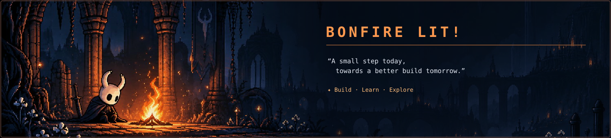
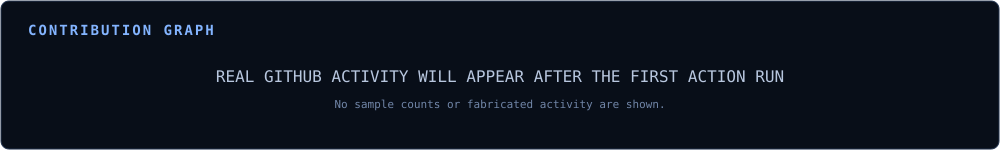

  
   
  

    <svg width="14" height="14" viewBox="0 0 24 24" fill="none" xmlns="http://www.w3.org/2000/svg" role="img" aria-label="Online status">
      <circle cx="12" cy="12" r="10" fill="#10b981" opacity="1">
        <animate attributeName="r" values="10;13;10" dur="2s" repeatCount="indefinite"/>
        <animate attributeName="opacity" values="1;0.4;1" dur="2s" repeatCount="indefinite"/>
      </circle>
      <circle cx="12" cy="12" r="4" fill="#10b981"/>
    </svg>
    ONLINE · BUILDING CHRONA
  

   
  
  &nbsp;
  
  &nbsp;
  
  &nbsp;
  

---

<strong>▼ &nbsp; LIGHT BONFIRE</strong>

 

  

  
<em>“A small step today, towards a better build tomorrow.”</em>

  

    ➤ &nbsp; Currently building <a href="https://github.com/Abpattar/Chrona"><strong>Chrona</strong></a> — a local-first Android planner 
    ⚒ &nbsp; Exploring full-stack apps, AI-assisted workflows, automation, and IoT 
    ◈ &nbsp; Learning to build software that is useful, thoughtful, and secure 
    ✦ &nbsp; Next quest: ship more Android apps and practical projects
  

  

    
    &nbsp;
    
    &nbsp;
    
  

---

<table>
  <tr>
    <td width="31%" valign="top">
      
    </td>
    <td valign="top">
      <h3><code>&gt; about.me</code></h3>
      
<code>name&nbsp;&nbsp;&nbsp;&nbsp;&nbsp;: Aditya B. Pattar role&nbsp;&nbsp;&nbsp;&nbsp;&nbsp;: IoT Student · Developer · Builder location : India focus&nbsp;&nbsp;&nbsp;&nbsp;: Full-stack, AI, Android, IoT mindset&nbsp;&nbsp;: Build useful things. Keep learning.</code>

      
I'm a full-stack developer who enjoys turning ideas into tools people can actually use. I like moving between web applications, Android development, AI-powered workflows, and IoT experiments. I'm also interested in how software works under the hood — especially authentication, access control, and building systems that behave securely.

      
<code>&gt; currently</code> Building Chrona and learning by shipping practical projects one step at a time.

    </td>
  </tr>
</table>

---

<h3><code>&gt; current.quest</code></h3>

**Chrona — Personal Android Planner** · [Repository ↗](https://github.com/Abpattar/Chrona)

A local-first planner built with **Kotlin** and **Jetpack Compose**. The goal is to make it easier to capture tasks, create a workable day plan, and adjust when real life gets in the way — while keeping the core experience useful offline.

Also exploring full-stack tools, AI-assisted automation, app-building patterns, and prototypes that connect software with real-world problems.

<h3><code>&gt; next.areas</code></h3>

- **Android app development:** build and ship more complete, polished apps.
- **AI & automation:** make useful workflows simpler without making them fragile or dependent on paid APIs.
- **Web security:** keep learning Broken Access Control, IDOR, and API authorization testing.
- **IoT:** combine software and hardware to solve practical problems.

---

<h3><code>&gt; tech.stack</code></h3>

**Languages & currently learning**

**Web & app development**

**Backend, data & infrastructure**

**Tools & workflow**

---

<h3><code>&gt; stats.from.the.kingdom</code></h3>

  
  &nbsp;
  
  &nbsp;
  

<h3><code>&gt; contribution.graph</code></h3>

  
  The graph is generated from the public GitHub contribution calendar. The included workflow refreshes it weekly.

  
  

One commit, one lesson, one small step at a time.

---

<h3><code>&gt; find.me</code></h3>

  <a href="https://github.com/Abpattar">GitHub</a>
  &nbsp; · &nbsp;
  <a href="https://www.linkedin.com/in/aditya-pattar-261a6834b/">LinkedIn</a>
  &nbsp; · &nbsp;
  <a href="mailto:adityabpattar@gmail.com">Email</a>
  <!-- Add portfolio, YouTube, or other public links here whenever you're ready. -->

---

  Hallownest-inspired fan aesthetic · Original generated artwork · Built one commit at a time.

